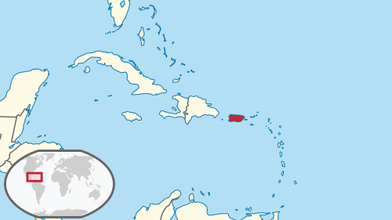

---
id    = "4f224124-3dde-5ef3-a608-df952201c542"
model = "Basic"
tags  = ["caribbean", "north_america", "map"]
---

## Front

What is highlighted on this map?

## Back

<b>Puerto Rico</b>

## Extra

Unincorporated territory of the United States.
