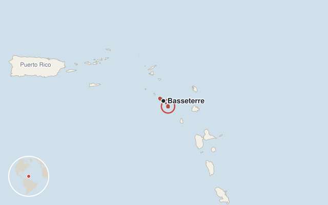

---
id    = "6eccaddc-ca6f-5826-bd1a-e43a30c0f88d"
model = "Basic"
tags  = ["caribbean", "north_america", "sovereign_state", "capital"]
---

## Front

What is the capital of <b>Saint Kitts and Nevis</b>?

## Back

<b>Basseterre</b>

## Extra

About 12,900 people (2025) On the south-western coast of Saint Kitts

The French founded it in 1627 under Sieur Pierre Belain d'Esnambuc. It is one of the oldest towns in the Eastern Caribbean and a chief commercial depot of the Leeward Islands.

<a href="https://en.wikipedia.org/wiki/Basseterre">Basseterre on Wikipedia</a> <a href="https://en.wikipedia.org/wiki/Saint_Kitts_and_Nevis">Saint Kitts and Nevis on Wikipedia</a>
