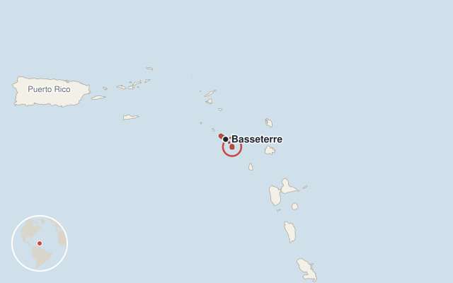

---
id    = "da1f985c-d655-5dbe-af12-95e5eddfaa0e"
model = "Basic"
tags  = ["caribbean", "north_america", "sovereign_state", "country"]
---

## Front

<b>Basseterre</b> is the capital of which country or territory?

## Back

<b>Saint Kitts and Nevis</b>

## Extra

<a href="https://en.wikipedia.org/wiki/Saint_Kitts_and_Nevis">Saint Kitts and Nevis on Wikipedia</a> <a href="https://en.wikipedia.org/wiki/Basseterre">Basseterre on Wikipedia</a>
