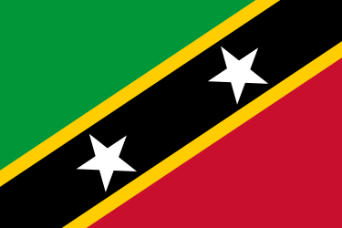
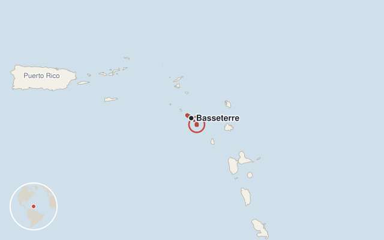

---
id    = "601a0d06-0d4a-5afc-a93a-9772d1e908df"
model = "Basic"
tags  = ["caribbean", "north_america", "sovereign_state", "flag"]
---

## Front

Whose flag is this?

## Back

<b>Saint Kitts and Nevis</b>

## Extra

Adopted in 1983, at independence

It uses the colours of the Pan-Africanist movement, though the symbolism is interpreted differently. A yellow-edged black band with two white stars runs diagonally between a green and a red triangle.

<a href="https://en.wikipedia.org/wiki/Flag_of_Saint_Kitts_and_Nevis">Flag of Saint Kitts and Nevis on Wikipedia</a> <a href="https://en.wikipedia.org/wiki/Saint_Kitts_and_Nevis">Saint Kitts and Nevis on Wikipedia</a>
