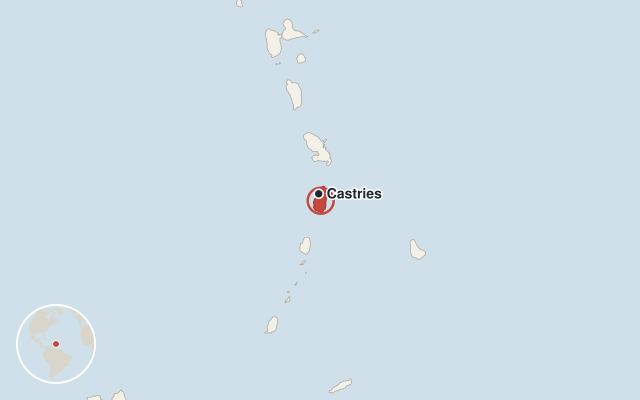

---
id    = "ff90eade-6807-5a22-9912-937845073c87"
model = "Basic"
tags  = ["caribbean", "north_america", "sovereign_state", "capital"]
---

## Front

What is the capital of <b>Saint Lucia</b>?

## Back

<b>Castries</b>

## Extra

About 20,000 people in the urban area (2013) Built on reclaimed land, on a flood plain

Its sheltered harbour receives cargo vessels, ferries and cruise ships. Two Nobel winners were born here: Arthur Lewis (Economics, 1979) and Derek Walcott (Literature, 1992).

<a href="https://en.wikipedia.org/wiki/Castries">Castries on Wikipedia</a> <a href="https://en.wikipedia.org/wiki/Saint_Lucia">Saint Lucia on Wikipedia</a>
