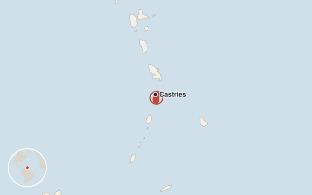

---
id    = "2cd76a00-ccab-507d-ae4d-fa6048738a00"
model = "Basic"
tags  = ["caribbean", "north_america", "sovereign_state", "country"]
---

## Front

<b>Castries</b> is the capital of which country or territory?

## Back

<b>Saint Lucia</b>

## Extra

<a href="https://en.wikipedia.org/wiki/Saint_Lucia">Saint Lucia on Wikipedia</a> <a href="https://en.wikipedia.org/wiki/Castries">Castries on Wikipedia</a>
