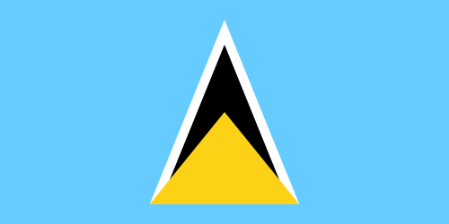
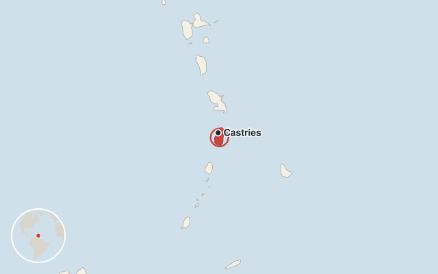

---
id    = "70843fee-29e4-5a0c-bd88-9f0b60d40b7e"
model = "Basic"
tags  = ["caribbean", "north_america", "sovereign_state", "flag"]
---

## Front

Whose flag is this?

## Back

<b>Saint Lucia</b>

## Extra

<a href="https://en.wikipedia.org/wiki/Flag_of_Saint_Lucia">Flag of Saint Lucia on Wikipedia</a> <a href="https://en.wikipedia.org/wiki/Saint_Lucia">Saint Lucia on Wikipedia</a>
