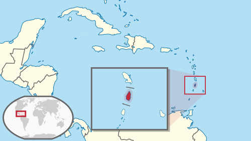
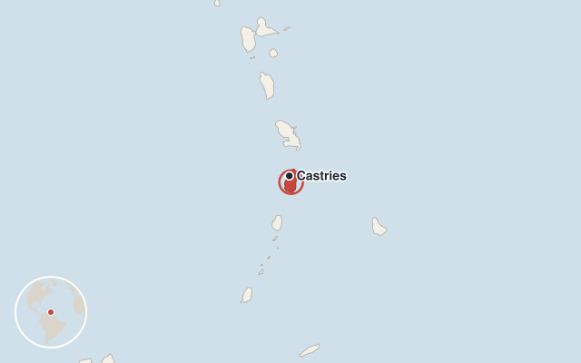

---
id    = "71ac0390-b6bf-5c3b-aef9-676b285120d7"
model = "Basic"
tags  = ["caribbean", "north_america", "sovereign_state", "map"]
---

## Front

What is highlighted on this map?

## Back

<b>Saint Lucia</b>

## Extra

North of Saint Vincent and south of Martinique Highest point Mount Gimie

Part of the Windward Islands of the Lesser Antilles, northwest of Barbados.

<a href="https://en.wikipedia.org/wiki/Saint_Lucia">Saint Lucia on Wikipedia</a>
