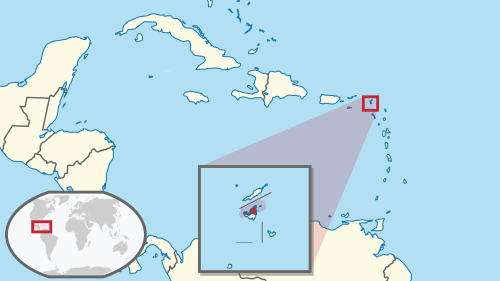

---
id    = "27d39f3c-6600-5940-96e9-c062c9c25d35"
model = "Basic"
tags  = ["caribbean", "north_america", "map"]
---

## Front

What is highlighted on this map?

## Back

<b>Saint Martin</b>

## Extra

About 53 km², the northern 60% of the island Capital Marigot

Separated from Anguilla by the Anguilla Channel. It shares the island with Sint Maarten, the southern part.

Overseas territory of France.

<a href="https://en.wikipedia.org/wiki/Collectivity_of_Saint_Martin">Collectivity of Saint Martin on Wikipedia</a>
