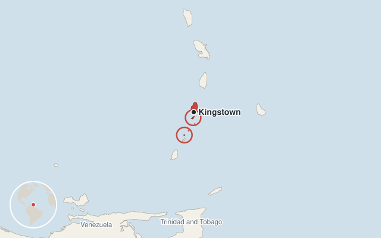

---
id    = "4fa3bc43-f5b5-5ca3-8d18-da0a10e7ff9f"
model = "Basic"
tags  = ["caribbean", "north_america", "sovereign_state", "capital"]
---

## Front

What is the capital of <b>Saint Vincent and the Grenadines</b>?

## Back

<b>Kingstown</b>

## Extra

<a href="https://en.wikipedia.org/wiki/Kingstown">Kingstown on Wikipedia</a> <a href="https://en.wikipedia.org/wiki/Saint_Vincent_and_the_Grenadines">Saint Vincent and the Grenadines on Wikipedia</a>
