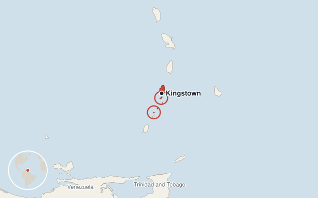

---
id    = "2f68c266-d294-5885-89cf-5b4b9aa8835d"
model = "Basic"
tags  = ["caribbean", "north_america", "sovereign_state", "country"]
---

## Front

<b>Kingstown</b> is the capital of which country or territory?

## Back

<b>Saint Vincent and the Grenadines</b>

## Extra

About 109,000 people (2023) in 389 km²

It holds the northern two-thirds of the Grenadines, a chain of 32 smaller islands. The southern third belongs to Grenada.

<a href="https://en.wikipedia.org/wiki/Saint_Vincent_and_the_Grenadines">Saint Vincent and the Grenadines on Wikipedia</a> <a href="https://en.wikipedia.org/wiki/Kingstown">Kingstown on Wikipedia</a>
