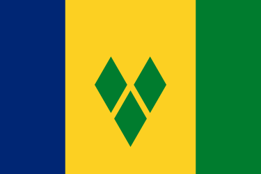
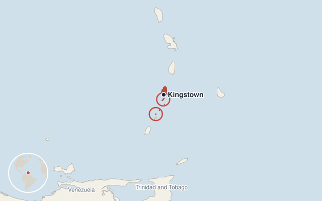

---
id    = "f203358e-c324-58b3-9873-1d24303e84b9"
model = "Basic"
tags  = ["caribbean", "north_america", "sovereign_state", "flag"]
---

## Front

Whose flag is this?

## Back

<b>Saint Vincent and the Grenadines</b>

## Extra

<a href="https://en.wikipedia.org/wiki/Flag_of_Saint_Vincent_and_the_Grenadines">Flag of Saint Vincent and the Grenadines on Wikipedia</a> <a href="https://en.wikipedia.org/wiki/Saint_Vincent_and_the_Grenadines">Saint Vincent and the Grenadines on Wikipedia</a>
