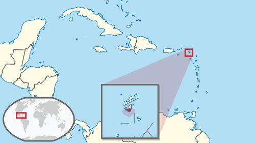

---
id    = "a605f3c4-201f-5f11-9e69-4a131d0bab44"
model = "Basic"
tags  = ["caribbean", "north_america", "map"]
---

## Front

What is highlighted on this map?

## Back

<b>Sint Maarten</b>

## Extra

Constituent country of the Kingdom of the Netherlands.
