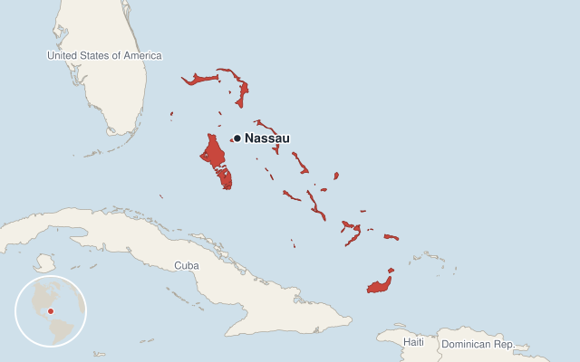
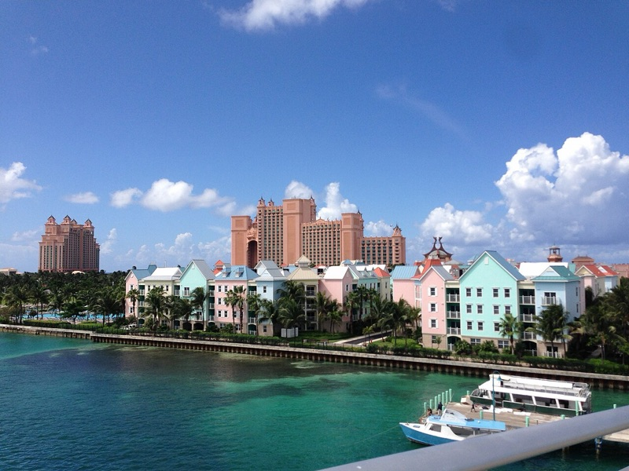

---
id    = "9b610e07-babd-5625-b52d-f27645e46fdb"
model = "Basic"
tags  = ["caribbean", "north_america", "sovereign_state", "capital"]
---

## Front

What is the capital of <b>The Bahamas</b>?

## Back

<b>Nassau</b>

## Extra

<i>Photo: Der-wuppertaler, CC BY-SA 3.0, via Wikimedia Commons</i>

About 228,000 people (2025) On New Providence, home to 74% of the country's people

Named in honour of William III of England, Prince of Orange-Nassau. It was historically considered a stronghold of pirates.

<a href="https://en.wikipedia.org/wiki/Nassau,_Bahamas">Nassau, Bahamas on Wikipedia</a> <a href="https://en.wikipedia.org/wiki/The_Bahamas">The Bahamas on Wikipedia</a>
