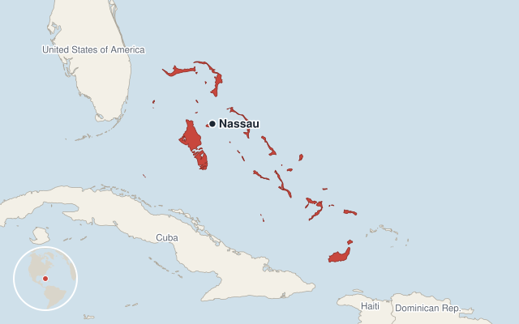

---
id    = "d845878c-2f20-5a64-8ae0-9a78fe64df1d"
model = "Basic"
tags  = ["caribbean", "north_america", "sovereign_state", "country"]
---

## Front

<b>Nassau</b> is the capital of which country or territory?

## Back

<b>The Bahamas</b>

## Extra

About 399,000 people (2023) in 13,878 km²

An archipelago of 700 islands and more than 2,500 cays.

<a href="https://en.wikipedia.org/wiki/The_Bahamas">The Bahamas on Wikipedia</a> <a href="https://en.wikipedia.org/wiki/Nassau,_Bahamas">Nassau, Bahamas on Wikipedia</a>
