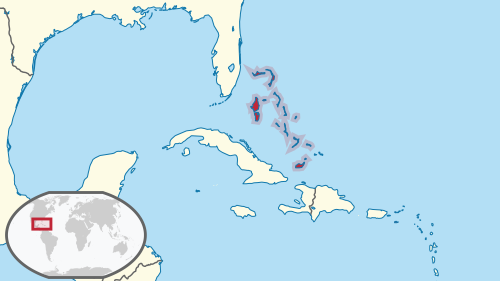
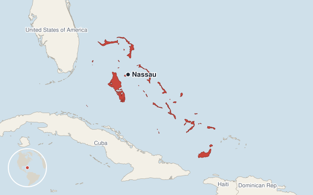

---
id    = "4c62686c-06c0-5e95-9a56-4b3bba75827f"
model = "Basic"
tags  = ["caribbean", "north_america", "sovereign_state", "map"]
---

## Front

What is highlighted on this map?

## Back

<b>The Bahamas</b>

## Extra

Highest point Mount Alvernia Territory covers 470,000 km² of ocean space

It lies in the Lucayan Archipelago in the Atlantic Ocean, north of Cuba and northwest of Hispaniola, and southeast of Florida and east of the Florida Keys.

<a href="https://en.wikipedia.org/wiki/The_Bahamas">The Bahamas on Wikipedia</a>
