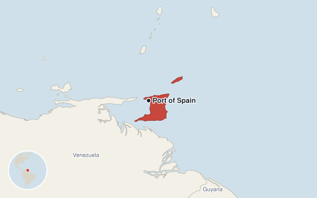
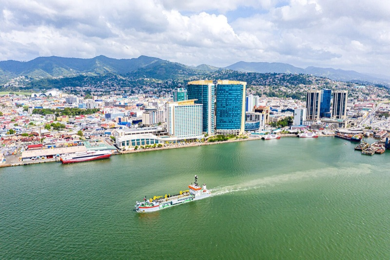

---
id    = "e1225a13-a18a-5963-afe5-d8c04987e2b6"
model = "Basic"
tags  = ["caribbean", "north_america", "sovereign_state", "capital"]
---

## Front

What is the capital of <b>Trinidad and Tobago</b>?

## Back

<b>Port of Spain</b>

## Extra

<i>Photo: Itrydisrespxtsmtsep, CC0, via Wikimedia Commons</i>

About 49,900 people in the municipality (2017) On the Gulf of Paria, on the northwest coast of Trinidad

It has been the island's capital since 1757. It is part of a conurbation of about 600,000 people stretching from Chaguaramas to Arima.

<a href="https://en.wikipedia.org/wiki/Port_of_Spain">Port of Spain on Wikipedia</a> <a href="https://en.wikipedia.org/wiki/Trinidad_and_Tobago">Trinidad and Tobago on Wikipedia</a>
