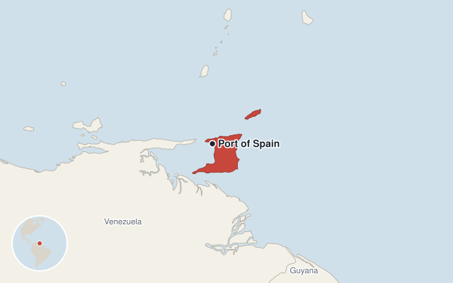
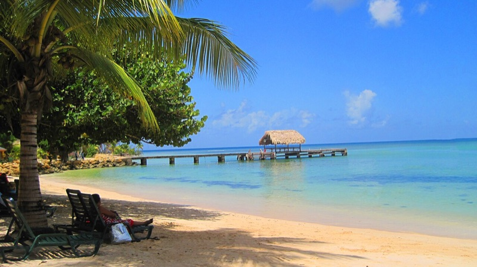

---
id    = "39c0cbd4-ddc2-53c6-b7c1-087b2073d901"
model = "Basic"
tags  = ["caribbean", "north_america", "sovereign_state", "country"]
---

## Front

<b>Port of Spain</b> is the capital of which country or territory?

## Back

<b>Trinidad and Tobago</b>

## Extra

<i>Photo: Kp93, CC BY-SA 3.0, via Wikimedia Commons</i>

About 1.37 million people (2017) in 5,128 km² Southernmost archipelagic country in the Caribbean

Birthplace of the steelpan, the limbo, and musical styles such as calypso and soca. Its large Carnival reflects its African and Indian cultures.

<a href="https://en.wikipedia.org/wiki/Trinidad_and_Tobago">Trinidad and Tobago on Wikipedia</a> <a href="https://en.wikipedia.org/wiki/Port_of_Spain">Port of Spain on Wikipedia</a>
