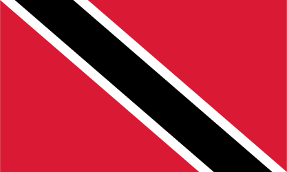

---
id    = "a5e4821f-6369-538b-95ff-eb9dab784559"
model = "Basic"
tags  = ["caribbean", "north_america", "sovereign_state", "flag"]
---

## Front

Whose flag is this?

## Back

<b>Trinidad and Tobago</b>
