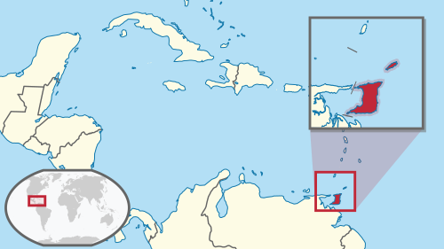

---
id    = "ccf57a20-b216-54d3-800b-71ff7d0ca308"
model = "Basic"
tags  = ["caribbean", "north_america", "sovereign_state", "map"]
---

## Front

What is highlighted on this map?

## Back

<b>Trinidad and Tobago</b>
