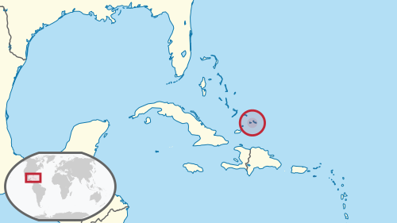
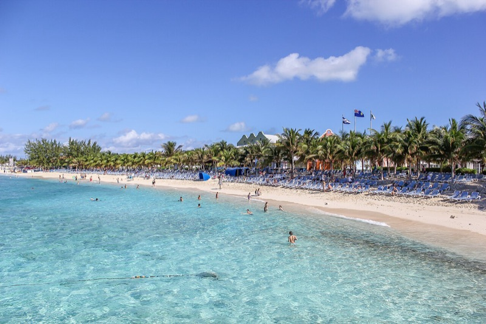

---
id    = "dc59e6c5-77e1-51d8-a59e-44bfef0f7193"
model = "Basic"
tags  = ["caribbean", "north_america", "map"]
---

## Front

What is highlighted on this map?

## Back

<b>Turks and Caicos Islands</b>

## Extra

<i>Photo: Jonathan Palombo, CC BY 2.0, via Wikimedia Commons</i>

Two island groups, the larger Caicos Islands and the smaller Turks Islands About 52,000 people (2025 estimate) on 430 km²

Caicos comes from the Lucayan caya hico, "string of islands". The Turks Islands are named after the Turk's cap cactus, whose red top resembles a fez.

Overseas territory of the United Kingdom.

<a href="https://en.wikipedia.org/wiki/Turks_and_Caicos_Islands">Turks and Caicos Islands on Wikipedia</a>
