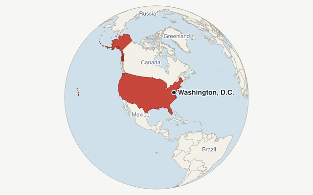
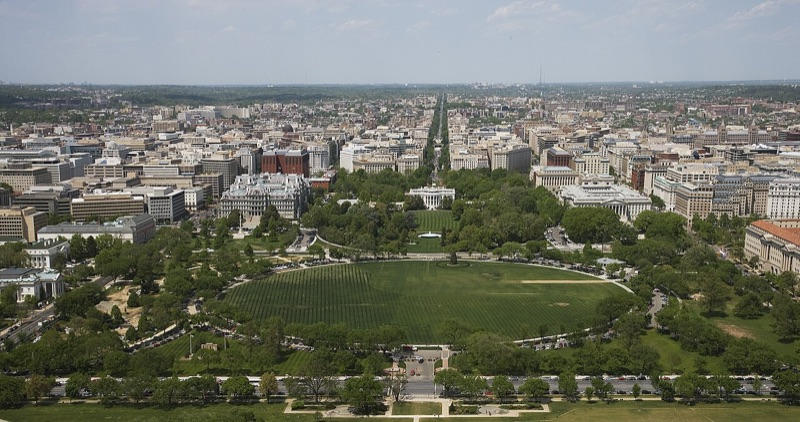

---
id    = "1bfb8964-a9fd-5e72-be12-cd1ff8c54836"
model = "Basic"
tags  = ["north_america", "sovereign_state", "capital"]
---

## Front

What is the capital of <b>United States of America</b>?

## Back

<b>Washington, D.C.</b>

## Extra

<i>Photo: Carol M. Highsmith, Public domain, via Wikimedia Commons</i>

About 690,000 people (2020 census) On the northeast bank of the Potomac River, bordered by Maryland and Virginia

A federal district that belongs to no state, created by the Residence Act of 1790. It is named for Columbia, a personification of the nation, and the capital moved here from Philadelphia in 1800.

<a href="https://en.wikipedia.org/wiki/Washington,_D.C.">Washington, D.C. on Wikipedia</a> <a href="https://en.wikipedia.org/wiki/United_States">United States on Wikipedia</a>
