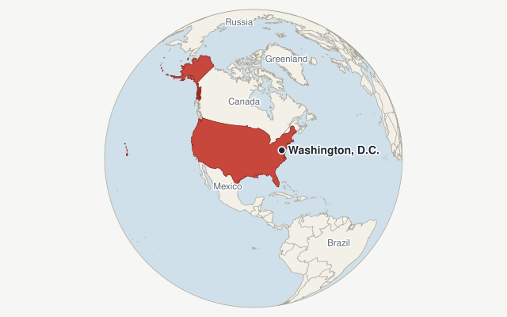

---
id    = "b75fc0de-e36d-5ff3-849f-b47eabd21333"
model = "Basic"
tags  = ["north_america", "sovereign_state", "country"]
---

## Front

<b>Washington, D.C.</b> is the capital of which country or territory?

## Back

<b>United States of America</b>

## Extra

<a href="https://en.wikipedia.org/wiki/United_States">United States on Wikipedia</a> <a href="https://en.wikipedia.org/wiki/Washington,_D.C.">Washington, D.C. on Wikipedia</a>
