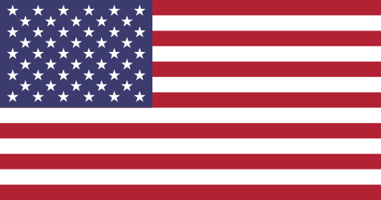
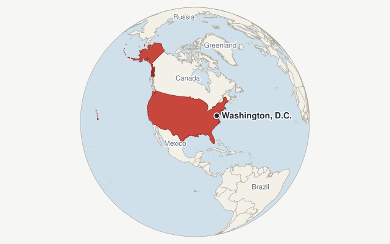

---
id    = "4ccad295-8b54-533a-859b-809275a9d094"
model = "Basic"
tags  = ["north_america", "sovereign_state", "flag"]
---

## Front

Whose flag is this?

## Back

<b>United States of America</b>

## Extra

<a href="https://en.wikipedia.org/wiki/Flag_of_the_United_States">Flag of the United States on Wikipedia</a> <a href="https://en.wikipedia.org/wiki/United_States">United States on Wikipedia</a>
