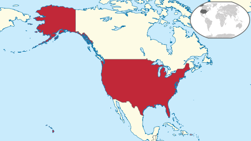
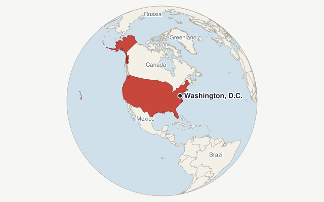

---
id    = "3585d1e1-ffec-5d87-b0da-08845f80db80"
model = "Basic"
tags  = ["north_america", "sovereign_state", "map"]
---

## Front

What is highlighted on this map?

## Back

<b>United States of America</b>

## Extra

Borders Canada to the north and Mexico to the south About 9.83 million km², the world's fourth-largest total area

The 48 contiguous states are joined by Alaska, a semi-exclave in the northwest, and Hawaii, an archipelago in the Pacific Ocean.

<a href="https://en.wikipedia.org/wiki/United_States">United States on Wikipedia</a>
