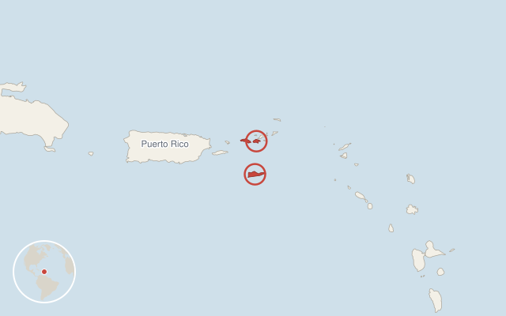

---
id    = "625660de-51bd-5a7f-9aa9-fa7909ffccdf"
model = "Basic"
tags  = ["caribbean", "north_america", "capital"]
---

## Front

What is the capital of <b>United States Virgin Islands</b>?

## Back

<b>Charlotte Amalie</b>

## Extra

Unincorporated territory of the United States.

<a href="https://en.wikipedia.org/wiki/Charlotte_Amalie,_U.S._Virgin_Islands">Charlotte Amalie, U.S. Virgin Islands on Wikipedia</a> <a href="https://en.wikipedia.org/wiki/United_States_Virgin_Islands">United States Virgin Islands on Wikipedia</a>
