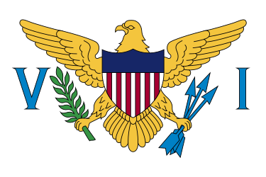
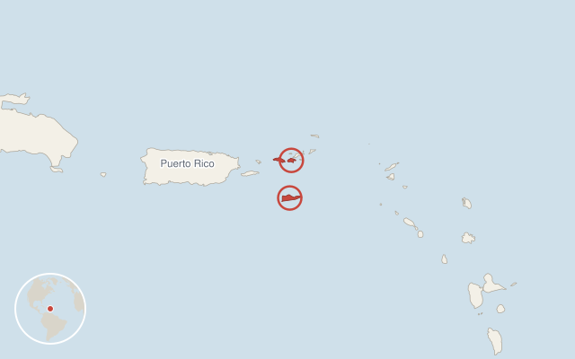

---
id    = "950048f7-2769-5b3e-9850-4502de989964"
model = "Basic"
tags  = ["caribbean", "north_america", "flag"]
---

## Front

Whose flag is this?

## Back

<b>United States Virgin Islands</b>

## Extra

Adopted on 17 May 1921

A simplified U.S. coat of arms between the letters V and I. The eagle holds three blue arrows, one for each major island: Saint Croix, Saint Thomas and Saint John.

Unincorporated territory of the United States.

<a href="https://en.wikipedia.org/wiki/Flag_of_the_United_States_Virgin_Islands">Flag of the United States Virgin Islands on Wikipedia</a> <a href="https://en.wikipedia.org/wiki/United_States_Virgin_Islands">United States Virgin Islands on Wikipedia</a>
