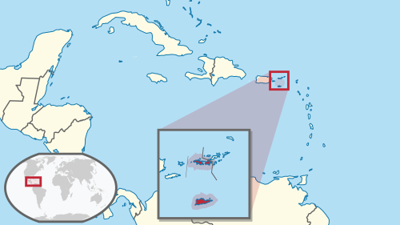

---
id    = "31f320ce-06df-5163-a6b1-c82f28539eb4"
model = "Basic"
tags  = ["caribbean", "north_america", "map"]
---

## Front

What is highlighted on this map?

## Back

<b>United States Virgin Islands</b>

## Extra

Unincorporated territory of the United States.
