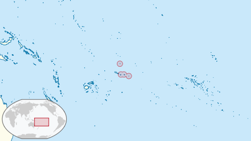
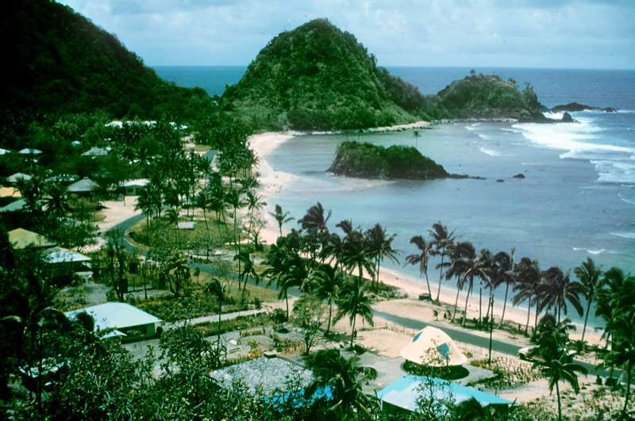

---
id    = "7cd1d0c7-e552-5369-bcdf-dc565ce00e69"
model = "Basic"
tags  = ["oceania", "map"]
---

## Front

What is highlighted on this map?

## Back

<b>American Samoa</b>

## Extra

<i>Photo: NOAA, Public domain, via Wikimedia Commons</i>

About 47,400 people (2024), mostly on Tutuila 199 km² of volcanic islands and atolls

The eastern part of the Samoan archipelago: five inhabited volcanic islands and the uninhabited Rose Atoll, plus Swains Island, a remote coral atoll in the Tokelau group.

Unincorporated territory of the United States.

<a href="https://en.wikipedia.org/wiki/American_Samoa">American Samoa on Wikipedia</a>
