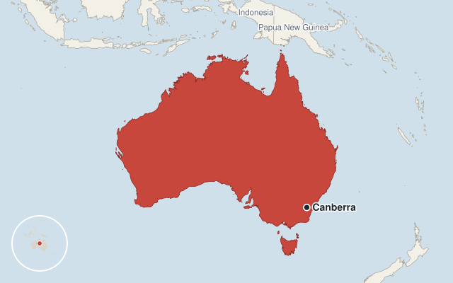
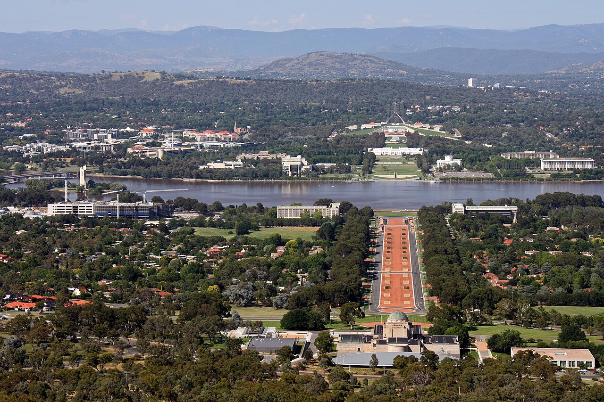

---
id    = "0d2bb512-1a15-500c-b876-c34419fc79c5"
model = "Basic"
tags  = ["oceania", "sovereign_state", "capital"]
---

## Front

What is the capital of <b>Australia</b>?

## Back

<b>Canberra</b>

## Extra

<i>Photo: Tim J Keegan from Lake Macquarie, Australia, CC BY-SA 2.0, via Wikimedia Commons</i>

About 474,000 people (2024) A planned city, founded in 1913 to a design by Walter Burley Griffin and Marion Mahony Griffin

Canberra exists because Sydney and Melbourne each wanted to be the capital. The compromise was a new city in New South Wales, at least 160 km from Sydney.

<a href="https://en.wikipedia.org/wiki/Canberra">Canberra on Wikipedia</a> <a href="https://en.wikipedia.org/wiki/Australia">Australia on Wikipedia</a>
