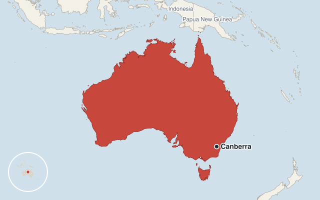

---
id    = "3f5a6326-7b02-5702-a601-86c7c358331e"
model = "Basic"
tags  = ["oceania", "sovereign_state", "country"]
---

## Front

<b>Canberra</b> is the capital of which country or territory?

## Back

<b>Australia</b>

## Extra

About 27.6 million people (2025) in 7.69 million km² The sixth-largest country in the world

The name comes from the Latin Terra Australis Incognita, 'unknown southern land'. Matthew Flinders popularised it after circumnavigating the continent in 1803.

<a href="https://en.wikipedia.org/wiki/Australia">Australia on Wikipedia</a> <a href="https://en.wikipedia.org/wiki/Canberra">Canberra on Wikipedia</a>
