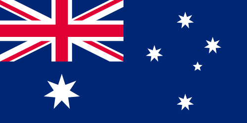
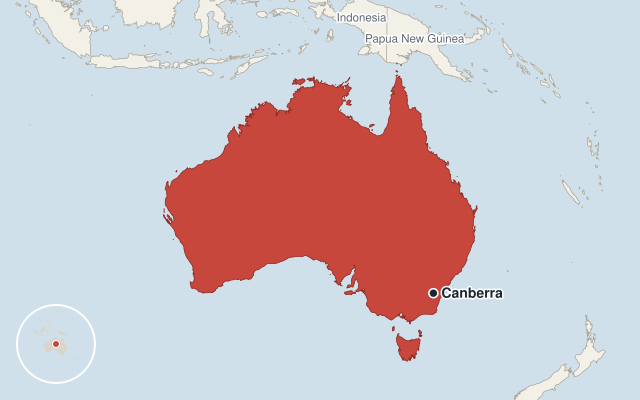

---
id    = "444593bb-8b3d-546c-81c2-fd2a20462222"
model = "Basic"
tags  = ["oceania", "sovereign_state", "flag"]
---

## Front

Whose flag is this?

## Back

<b>Australia</b>

## Extra

Similar flags: New Zealand (red stars, two fewer stars)

<a href="https://en.wikipedia.org/wiki/Flag_of_Australia">Flag of Australia on Wikipedia</a> <a href="https://en.wikipedia.org/wiki/Australia">Australia on Wikipedia</a>
