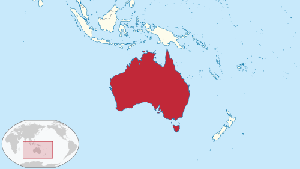
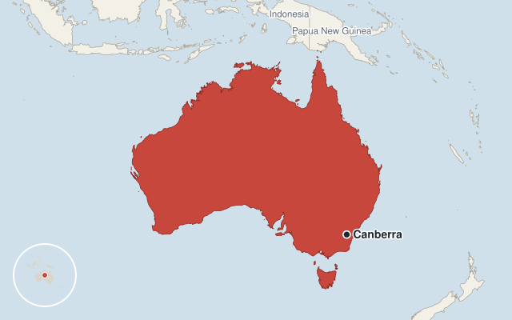
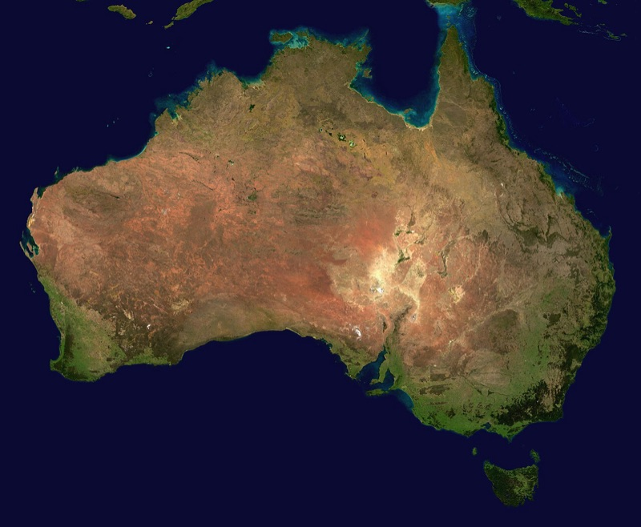

---
id    = "2798f44a-8cfc-5784-a971-0e54b6734409"
model = "Basic"
tags  = ["oceania", "sovereign_state", "map"]
---

## Front

What is highlighted on this map?

## Back

<b>Australia</b>

## Extra

<i>Photo: Reto Stöckl / NASA Goddard Space Flight Center, Public domain, via Wikimedia Commons</i>

Neighbours across the sea include Indonesia, Papua New Guinea and New Zealand Mainland, the island of Tasmania and many smaller islands

Large deserts fill the centre and tropical rainforests line parts of the coast. At 2,228 m, Mount Kosciuszko is the highest mountain on the mainland.

<a href="https://en.wikipedia.org/wiki/Australia">Australia on Wikipedia</a>
