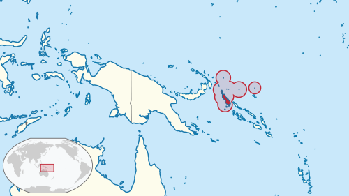
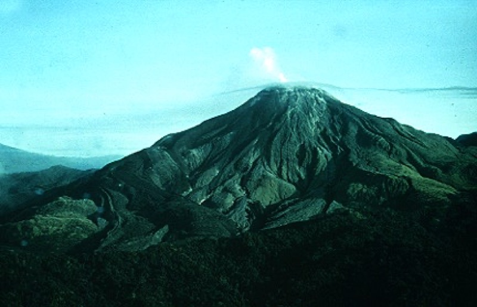

---
id    = "be47e415-2fc2-51c4-994b-1102908d32e0"
model = "Basic"
tags  = ["oceania", "map"]
---

## Front

What is highlighted on this map?

## Back

<b>Bougainville</b>

## Extra

<i>Photo: Photo courtesy of Jack Lockwood, U.S. Geological Survey., Public domain, via Wikimedia Commons</i>

About 367,000 people (2024) in 9,384 km² Main islands: Bougainville Island and Buka Island

Geographically it belongs to the Solomon Islands archipelago, but politically it is separate from the country of Solomon Islands: it is an autonomous region of Papua New Guinea.

Autonomous region of Papua New Guinea.

<a href="https://en.wikipedia.org/wiki/Autonomous_Region_of_Bougainville">Autonomous Region of Bougainville on Wikipedia</a>
