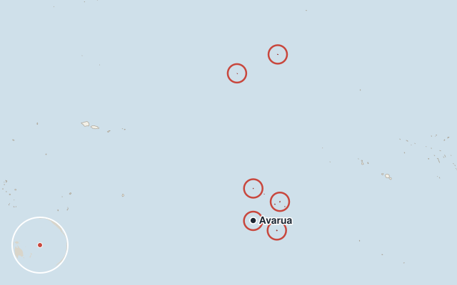
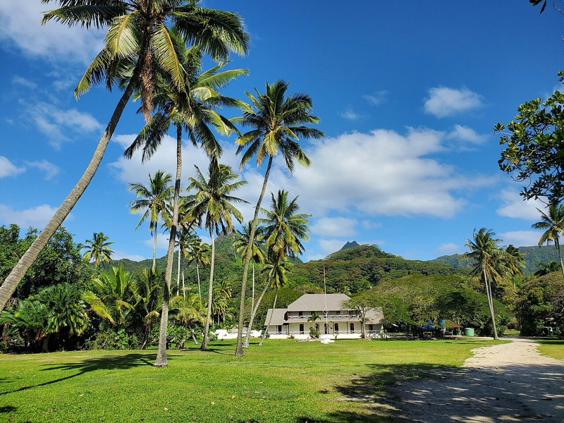

---
id    = "923d39fe-e692-56aa-ade8-0d335244f6d6"
model = "Basic"
tags  = ["oceania", "sovereign_state", "capital"]
---

## Front

What is the capital of <b>Cook Islands</b>?

## Back

<b>Avarua</b>

## Extra

<i>Photo: Nurg, CC BY-SA 4.0, via Wikimedia Commons</i>

About 5,100 people in the district (2021 census) In the north of Rarotonga, the largest of the Cook Islands

The name means "two harbours" in Māori. The town is built around Avatiu Harbour, the main port, and Avarua Harbour, once the main port and now a small fishing port.

<a href="https://en.wikipedia.org/wiki/Avarua">Avarua on Wikipedia</a> <a href="https://en.wikipedia.org/wiki/Cook_Islands">Cook Islands on Wikipedia</a>
