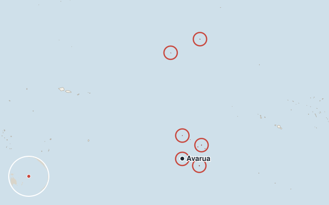
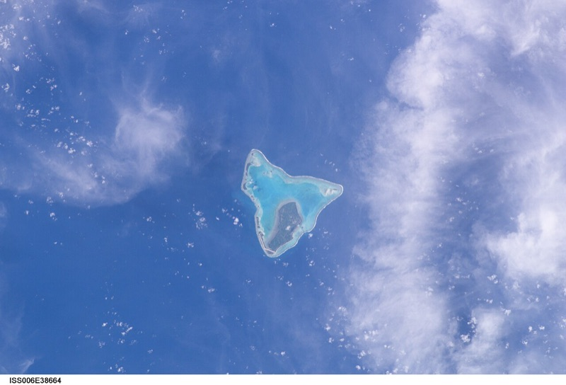

---
id    = "4071f666-f823-5c8d-bc65-722d3fa2f7e2"
model = "Basic"
tags  = ["oceania", "sovereign_state", "country"]
---

## Front

<b>Avarua</b> is the capital of which country or territory?

## Back

<b>Cook Islands</b>

## Extra

<i>Photo: Earth Science and Remote Sensing Unit, Lyndon B. Johnson Space Center, Public domain, via Wikimedia Commons</i>

About 15,000 people (2021 census)

Self-governing, but in free association with New Zealand. Most Cook Islanders hold New Zealand citizenship, and a larger population of Cook Islanders lives in New Zealand and Australia.

<a href="https://en.wikipedia.org/wiki/Cook_Islands">Cook Islands on Wikipedia</a> <a href="https://en.wikipedia.org/wiki/Avarua">Avarua on Wikipedia</a>
