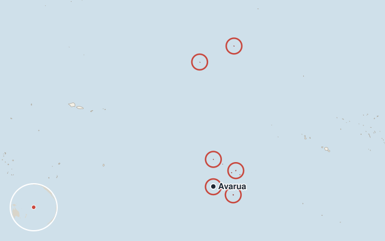

---
id    = "5a6592c5-6b36-578c-993c-e84adc5ed933"
model = "Basic"
tags  = ["oceania", "sovereign_state", "map"]
---

## Front

What is highlighted on this map?

## Back

<b>Cook Islands</b>

## Extra

<i>Photo: Earth Science and Remote Sensing Unit, Lyndon B. Johnson Space Center, Public domain, via Wikimedia Commons</i>

15 islands with about 236.7 km² of land In Polynesia, in the South Pacific Ocean

Small islands spread over a vast sea: their exclusive economic zone covers about 1.96 million km² of ocean, against about 237 km² of land.

<a href="https://en.wikipedia.org/wiki/Cook_Islands">Cook Islands on Wikipedia</a>
