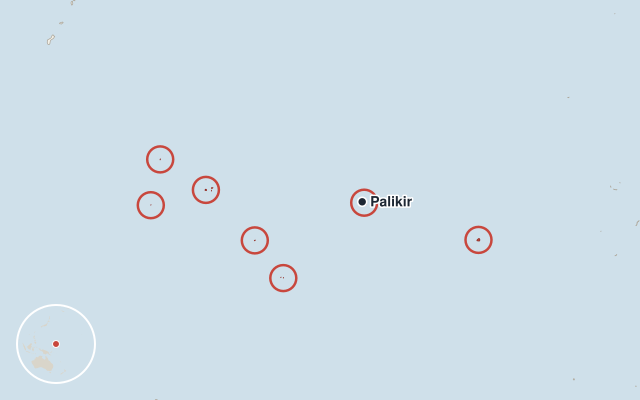

---
id    = "db9579a4-b0b4-5659-a416-414aa0ff78c8"
model = "Basic"
tags  = ["oceania", "sovereign_state", "capital"]
---

## Front

What is the capital of <b>Federated States of Micronesia</b>?

## Back

<b>Palikir</b>

## Extra

A town of slightly above 5,000 residents On the northwest side of Pohnpei, a high volcanic island ringed by a coral reef

It was declared the capital in 1989 and is now the hub of the federal administration. Kolonia, the island's largest settlement, lies nearby to the northeast.

<a href="https://en.wikipedia.org/wiki/Palikir">Palikir on Wikipedia</a> <a href="https://en.wikipedia.org/wiki/Federated_States_of_Micronesia">Federated States of Micronesia on Wikipedia</a>
