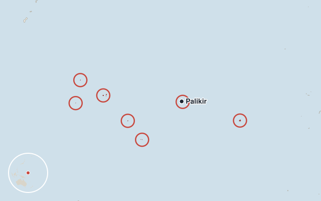

---
id    = "3e8fc95d-345d-56e0-a717-fa0d749645db"
model = "Basic"
tags  = ["oceania", "sovereign_state", "country"]
---

## Front

<b>Palikir</b> is the capital of which country or territory?

## Back

<b>Federated States of Micronesia</b>

## Extra

Four states: Yap, Chuuk, Pohnpei and Kosrae Highest point: Dolohmwar

It became a sovereign state on 3 November 1986, under a Compact of Free Association with the United States. Before that it was part of the US-administered Trust Territory of the Pacific Islands.

<a href="https://en.wikipedia.org/wiki/Federated_States_of_Micronesia">Federated States of Micronesia on Wikipedia</a> <a href="https://en.wikipedia.org/wiki/Palikir">Palikir on Wikipedia</a>
