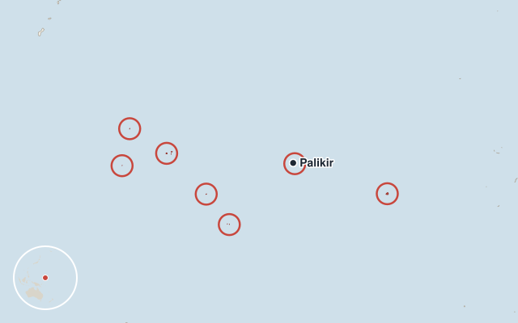

---
id    = "096a2edf-baac-5aba-9d56-b8f1d989bbf9"
model = "Basic"
tags  = ["oceania", "sovereign_state", "flag"]
---

## Front

Whose flag is this?

## Back

<b>Federated States of Micronesia</b>

## Extra

<a href="https://en.wikipedia.org/wiki/Flag_of_the_Federated_States_of_Micronesia">Flag of the Federated States of Micronesia on Wikipedia</a> <a href="https://en.wikipedia.org/wiki/Federated_States_of_Micronesia">Federated States of Micronesia on Wikipedia</a>
