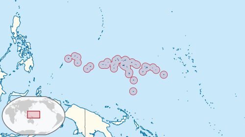

---
id    = "b213b5e1-90d8-5727-a0ee-2b3a5ee61d32"
model = "Basic"
tags  = ["oceania", "sovereign_state", "map"]
---

## Front

What is highlighted on this map?

## Back

<b>Federated States of Micronesia</b>
