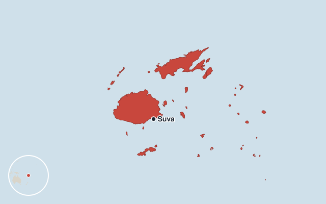
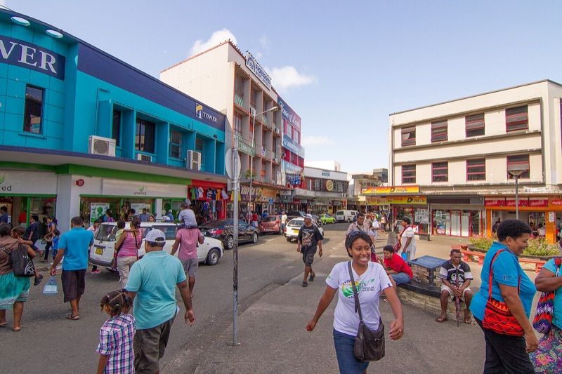

---
id    = "5420e413-28fe-55e5-ac67-df43b5a46915"
model = "Basic"
tags  = ["oceania", "sovereign_state", "capital"]
---

## Front

What is the capital of <b>Fiji</b>?

## Back

<b>Suva</b>

## Extra

<i>Photo: Maksym Kozlenko, CC BY-SA 4.0, via Wikimedia Commons</i>

About 94,000 people (2017 census), Fiji's most populous settlement On a hilly peninsula in the southeast of Viti Levu

In 1877 the capital moved here from Levuka, the main European colonial settlement, because of Levuka's restrictive geography. Suva is also Fiji's major port.

<a href="https://en.wikipedia.org/wiki/Suva">Suva on Wikipedia</a> <a href="https://en.wikipedia.org/wiki/Fiji">Fiji on Wikipedia</a>
