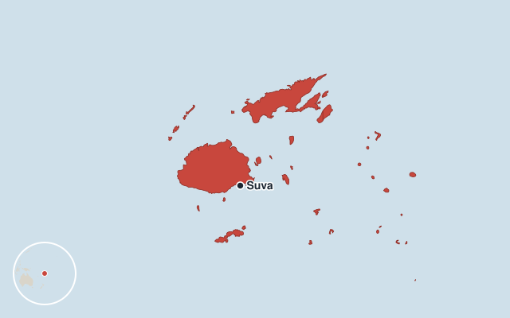

---
id    = "50895771-d0fc-53bb-bc02-a71502cd707c"
model = "Basic"
tags  = ["oceania", "sovereign_state", "country"]
---

## Front

<b>Suva</b> is the capital of which country or territory?

## Back

<b>Fiji</b>

## Extra

About 926,000 people (2018) in 18,300 km² Official languages: English, Fijian and Fiji Hindi

About 87% of the population lives on the two major islands, Viti Levu and Vanua Levu. The interior of Viti Levu is sparsely inhabited because of its terrain.

<a href="https://en.wikipedia.org/wiki/Fiji">Fiji on Wikipedia</a> <a href="https://en.wikipedia.org/wiki/Suva">Suva on Wikipedia</a>
