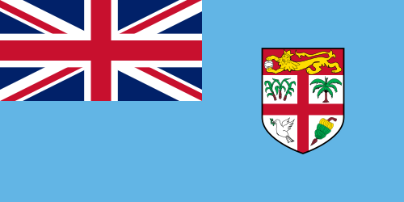
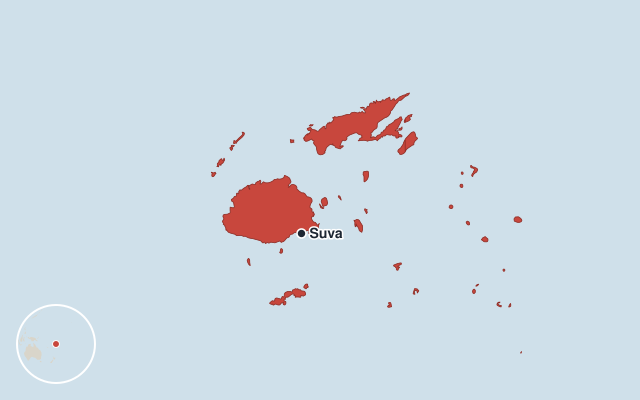

---
id    = "90cefbda-e07e-57dd-9d7d-d614d274424d"
model = "Basic"
tags  = ["oceania", "sovereign_state", "flag"]
---

## Front

Whose flag is this?

## Back

<b>Fiji</b>

## Extra

Adopted on 10 October 1970, the year Fiji's time as a British colony ended

The light blue field is the Pacific Ocean, and the Union Jack reflects links with the United Kingdom. The shield comes from the national coat of arms, granted by royal warrant in 1908.

<a href="https://en.wikipedia.org/wiki/Flag_of_Fiji">Flag of Fiji on Wikipedia</a> <a href="https://en.wikipedia.org/wiki/Fiji">Fiji on Wikipedia</a>
