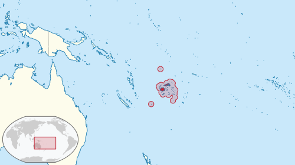

---
id    = "3f741a9f-9dce-5696-910c-47f332721454"
model = "Basic"
tags  = ["oceania", "sovereign_state", "map"]
---

## Front

What is highlighted on this map?

## Back

<b>Fiji</b>

## Extra

More than 330 islands and more than 500 islets About 2,000 km north-northeast of New Zealand

Most of the islands were formed by volcanic activity, starting around 150 million years ago. Some geothermal activity still occurs on Vanua Levu and Taveuni.

<a href="https://en.wikipedia.org/wiki/Fiji">Fiji on Wikipedia</a>
