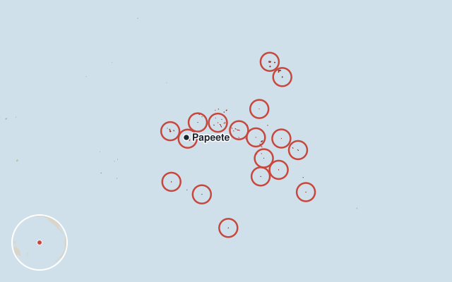

---
id    = "598b959a-1204-5754-b818-9a2cfecb7952"
model = "Basic"
tags  = ["oceania", "capital"]
---

## Front

What is the capital of <b>French Polynesia</b>?

## Back

<b>Papeete</b>

## Extra

Overseas territory of France.

<a href="https://en.wikipedia.org/wiki/Papeete">Papeete on Wikipedia</a> <a href="https://en.wikipedia.org/wiki/French_Polynesia">French Polynesia on Wikipedia</a>
