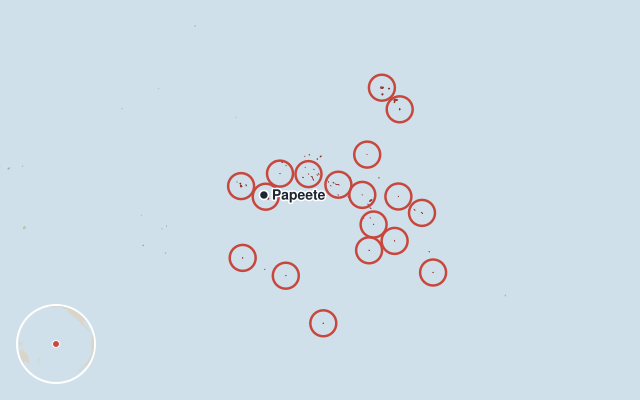

---
id    = "54dbd8d5-8545-58c4-b12b-82955bbc0212"
model = "Basic"
tags  = ["oceania", "country"]
---

## Front

<b>Papeete</b> is the capital of which country or territory?

## Back

<b>French Polynesia</b>

## Extra

Overseas territory of France.

<a href="https://en.wikipedia.org/wiki/French_Polynesia">French Polynesia on Wikipedia</a> <a href="https://en.wikipedia.org/wiki/Papeete">Papeete on Wikipedia</a>
