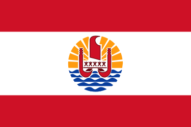

---
id    = "5a7a4ff2-e1e1-5d49-802c-2e86ae3432b1"
model = "Basic"
tags  = ["oceania", "flag"]
---

## Front

Whose flag is this?

## Back

<b>French Polynesia</b>

## Extra

Overseas territory of France.
