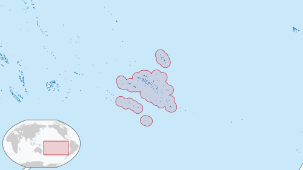
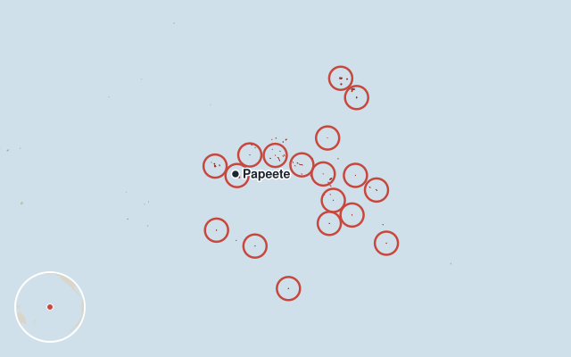

---
id    = "3a7c8e9c-745a-5423-a2b5-472d997cd8af"
model = "Basic"
tags  = ["oceania", "map"]
---

## Front

What is highlighted on this map?

## Back

<b>French Polynesia</b>

## Extra

Overseas territory of France.

<a href="https://en.wikipedia.org/wiki/French_Polynesia">French Polynesia on Wikipedia</a>
