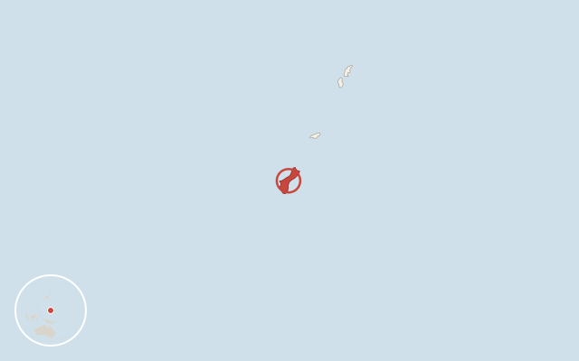

---
id    = "f3bef020-087b-5848-a215-56651814ec07"
model = "Basic"
tags  = ["oceania", "capital"]
---

## Front

What is the capital of <b>Guam</b>?

## Back

<b>Hagåtña</b>

## Extra

About 940 people (2020), the second smallest of Guam's 19 villages On the west coast, at the mouth of the Hagåtña River

Called Agana until 1998, when the Guam Legislature restored the original Chamorro name. It is the westernmost territorial capital city of the United States.

Unincorporated territory of the United States.

<a href="https://en.wikipedia.org/wiki/Hag%C3%A5t%C3%B1a,_Guam">Hagåtña, Guam on Wikipedia</a> <a href="https://en.wikipedia.org/wiki/Guam">Guam on Wikipedia</a>
